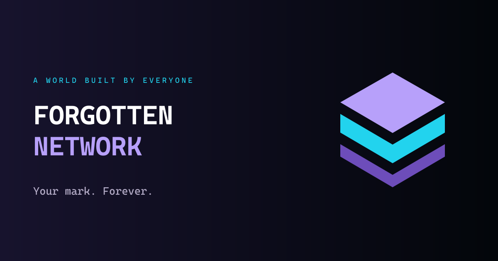
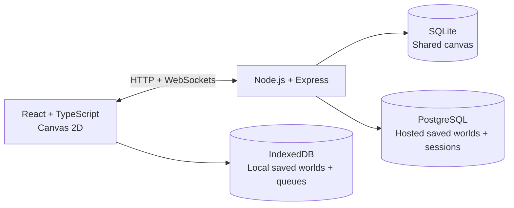

<p align="center">
  
</p>

<h1 align="center">Forgotten Network</h1>

<p align="center">
  A shared canvas for drawing, discovering, and creating together.<br />
  <strong>عالم مشترك للرسم والاستكشاف والإبداع.</strong>
</p>

<p align="center">
  <a href="PROJECT_GUIDE_AR.md">الدليل العربي</a> ·
  <a href="#quick-start">Quick start</a> ·
  <a href="docs/README.md">Documentation</a> ·
  <a href="docs/RENDER_DEPLOYMENT.md">Deploy on Render</a>
</p>

<p align="center">
  
  
  
</p>

---

## The world

Forgotten Network brings a drawing studio and a shared world into one browser experience. Leave a mark, explore nearby creations, and see other artists move across the canvas in real time. The server records ownership so artists can revise their own work while preserving its history.

The project also preserves earlier saved worlds through **Tools & saved worlds**. Those records keep their existing storage format and are not automatically published onto the shared canvas.

> **Project status:** active development. Local setup is available; public deployment is awaiting verification. See [launch readiness](docs/LAUNCH_READINESS.md) for the current operational status and remaining work.

## What you can do

|                           | Experience                                                                                                          |
| ------------------------- | ------------------------------------------------------------------------------------------------------------------- |
| **Draw & edit**           | Brushes, pixel tools, shapes, text, color palettes, and a raster studio with up to eight temporary layers.          |
| **Create together**       | Live cursors, drawing previews, chat, reactions, and server-enforced artwork ownership.                             |
| **Explore**               | Pan and zoom, use the minimap, discover neighborhoods, and share a link to a location.                              |
| **Keep your identity**    | Create an artist identity and download a private recovery key. Owner edits retain recoverable history.              |
| **Build a collection**    | Daily challenges, visit streaks, and a Creator Collection with local demo rewards.                                  |
| **Choose your interface** | English or Arabic for the main shell, onboarding, selected settings, and policy navigation; reduced-motion support. |

The full editor, moderation tools, and legal text are not yet translated. Uploaded images require moderator approval. Demo balances stay on the device and have no cash value. Details are in [localization](docs/POLISH_AND_LOCALIZATION.md), [safety](docs/TRUST_AND_SAFETY.md), and [rewards](docs/PHASE_3_IMPLEMENTATION.md).

## Quick start

### Requirements

- **Node.js 22.13+**, including the built-in `node:sqlite` module.
- **pnpm 11.25.0**, matching the repository's `packageManager` field.
- A browser supporting Canvas 2D, WebSockets, and IndexedDB.

```bash
git clone https://github.com/ABDILAZIZT/ForgottenNetwork.git
cd ForgottenNetwork
npm install --global pnpm@11.25.0
pnpm install --frozen-lockfile
pnpm start
```

Open **[localhost:5173](http://localhost:5173)**. The API runs at **[localhost:3001](http://localhost:3001/api/health)**.

The default development setup creates its local data stores automatically. No hosted database or identity provider is needed to try the main canvas. Keep your downloaded recovery key private.

### Useful commands

| Command                                   | Purpose                                                              |
| ----------------------------------------- | -------------------------------------------------------------------- |
| `pnpm start`                              | Run the client and server together.                                  |
| `pnpm start:client` / `pnpm start:server` | Run one service.                                                     |
| `pnpm check`                              | Check formatting, lint, tests, TypeScript, and the production build. |
| `pnpm build`                              | Build the frontend into `client/dist`.                               |
| `pnpm format`                             | Format the repository.                                               |

Environment options are documented in [`.env.example`](.env.example). The server reads process environment variables; it does not automatically load that file. Use your shell or hosting provider to supply overrides.

## How it fits together



| Area          | Location                                             | Responsibility                                                          |
| ------------- | ---------------------------------------------------- | ----------------------------------------------------------------------- |
| Shared studio | [`client/src/permanent`](client/src/permanent)       | Canvas interface, drawing tools, raster editor, and live collaboration. |
| Saved worlds  | [`client/src/repositories`](client/src/repositories) | IndexedDB and remote persistence adapters.                              |
| Canvas server | [`server/permanent`](server/permanent)               | Ownership, identities, artwork, moderation, and SQLite backups.         |
| Hosted API    | [`server`](server)                                   | Express, PostgreSQL, sessions, optional OIDC, and migrations.           |
| Shared types  | [`shared/src`](shared/src)                           | TypeScript contracts shared by project packages.                        |
| Documentation | [`docs`](docs/README.md)                             | Operation, architecture, product scope, and implementation history.     |

### Storage at a glance

- **Shared canvas:** SQLite holds artwork, identities, media, and community records. Production needs a persistent disk and independent backups.
- **Saved worlds:** IndexedDB in local mode; PostgreSQL in hosted mode. These records remain separate from the shared canvas.
- **Hosting:** one Node process serves the frontend and API. The SQLite world must not be split across independent replicas.

## Deployment

Start with the **[Render deployment guide](docs/RENDER_DEPLOYMENT.md)**. The checked-in [`render.yaml`](render.yaml) is a preview configuration: its free plans and missing persistent disk must be addressed before relying on it for public data.

Run `pnpm check` before publishing a change. The Blueprint is configured to deploy commits on `main`; verify the live Render service separately.

```bash
pnpm --dir server smoke https://YOUR-SERVICE.onrender.com FULL_40_CHARACTER_COMMIT_SHA
```

This read-only check verifies the frontend, its JavaScript/CSS assets, database readiness, and the deployed commit. A passing check does not prove backup recovery, persistent disk configuration, or moderation coverage.

## Documentation

| Looking for…                         | Start here                                                                                        |
| ------------------------------------ | ------------------------------------------------------------------------------------------------- |
| شرح المشروع بالعربية                 | [الدليل العربي](PROJECT_GUIDE_AR.md)                                                              |
| Hosting and release checks           | [Render deployment](docs/RENDER_DEPLOYMENT.md) · [Launch readiness](docs/LAUNCH_READINESS.md)     |
| Ownership, backups, and recovery     | [Permanent canvas guide](docs/PERMANENT_CANVAS.md)                                                |
| API and storage design               | [API contract](docs/API_CONTRACT.md) · [Repository architecture](docs/REPOSITORY_ARCHITECTURE.md) |
| Upload review and community controls | [Trust & safety](docs/TRUST_AND_SAFETY.md)                                                        |
| Optional advertising                 | [Ad configuration and consent](docs/AD_CONFIGURATION.md)                                          |
| All guides and implementation notes  | [Documentation index](docs/README.md)                                                             |

## Development notes

Keep changes focused and run `pnpm check` before proposing a release. Use disposable local data for verification; never commit credentials, recovery keys, database files, or backups. Existing migrations are checksummed—add a new migration instead of editing one already applied.

Advertising is disabled by default. Public hosting, provider credentials, moderator identities, and backup schedules are operator configuration, not bundled services.
